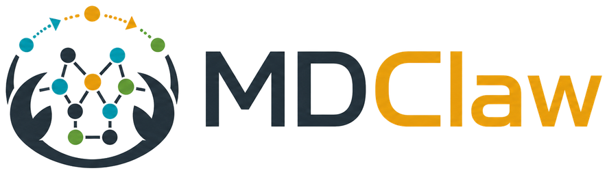
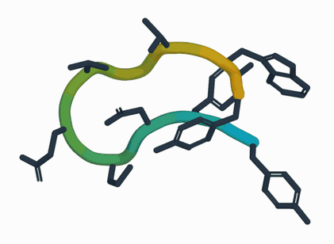
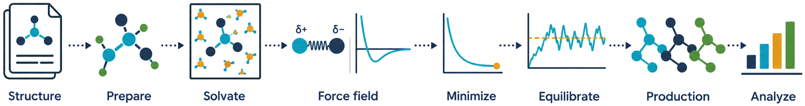

<p align="center">
  <picture>
    <source media="(prefers-color-scheme: dark)" srcset="docs/assets/mdclaw-logo-dark.png">
    
  </picture>
</p>

<p align="center">
  <strong>Molecular dynamics with AmberTools and OpenMM, driven by your AI coding agent.</strong><br>
  Describe the system or the question. Every stage is checked, recorded and resumable.
</p>

<p align="center">
  <a href="https://github.com/matsunagalab/mdclaw/actions/workflows/ci.yml"></a>
  <a href="https://github.com/matsunagalab/mdclaw/tags"></a>
  <a href="LICENSE"></a>
</p>

<p align="center">
  <a href="#install">Install</a> &nbsp;·&nbsp;
  <a href="#what-you-can-ask-for">Examples</a> &nbsp;·&nbsp;
  <a href="#capabilities">Capabilities</a> &nbsp;·&nbsp;
  <a href="#what-mdclaw-does-not-do">Limits</a> &nbsp;·&nbsp;
  <a href="docs/agents/deployment.md">Deployment guide</a>
</p>

<p align="center">
  <picture>
    <source media="(prefers-color-scheme: dark)" srcset="docs/assets/cln025-dark.gif">
    
  </picture>
</p>

<p align="center"><sub>Chignolin (CLN025, PDB 5AWL) at 300 K in ff19SB/OPC, from a 10 ns production run prepared and run with MDClaw.<br>A 2 ns excerpt: coordinates averaged over 90 ps for display, water and ions hidden, played forward and back to loop.</sub></p>

MDClaw gives agents such as Claude Code and Codex two things: **skills**, which
tell the agent what to do and why, and **command-line tools**, which do the work.
The tools are also the layer that can refuse. Molecule selection, force-field
templates, charges, stage dependencies and required files are checked in code,
and a failed check stops with a stable error code and the next action, rather
than relying on the agent to be careful.

Each stage records its inputs, outputs and status as a node in a directed acyclic
graph. A study can be inspected, resumed, branched or written up later, without
the original chat. You can also call the tools directly, with no agent at all.

<p align="center">
  <picture>
    <source media="(prefers-color-scheme: dark)" srcset="docs/assets/workflow-dark.png">
    
  </picture>
</p>

> [!IMPORTANT]
> A run that finishes is not a validated result. MDClaw's checks cover topology,
> charges, energies and files. They do not establish convergence, adequate
> sampling or a biological conclusion. Those need appropriate controls,
> replicates and expert review.

## What you can ask for

Start your agent in the directory where the simulation files should live, then
say what to do and where to stop.

**Prepare and equilibrate one system**

```text
Prepare PDB 1AKE chain A as a protein-only explicit-water system using the default
force field and water model. Continue through default equilibration and stop
before production.
```

**Compare systems and analyze the results**

```text
Set up and run an apo-vs-holo MD study for the T4 lysozyme L99A benzene-binding
cavity (benzene-bound PDB 4W53). Plan the minimal job set, run 50 ns of production
per job, compare RMSD, RMSF and cavity-lining distances, and state what the data
do and do not support.
```

**Estimate a free-energy change**

```text
Estimate the folding free-energy change of the T4 lysozyme L99A mutation by FEP,
and report the convergence diagnostics with the result.
```

**Watch a running job**

```text
Show the progress of prod_001 in Molstar.
```

To see a plan first, ask the agent to propose the study and stop before running
anything. For long simulations use a GPU, and say so if jobs should go through
Slurm.

## Install

MDClaw has two parts, installed separately: the **runtime** (the scientific
software that performs the calculations) and the **skills** (the instructions for
your agent). Set up the runtime first, on the machine that will run the
calculations.

### 1. Get the runtime

Find your machine below. On Linux with an NVIDIA GPU, `nvidia-smi` prints the
driver version.

| Your machine | GPU support | Runtime |
|---|---|---|
| Cluster, Linux x86-64, Singularity or Apptainer | CUDA 11.8, driver R520 or newer | [Container](#container-singularity-or-apptainer), `mdclaw:latest` |
| Cluster, Linux ARM64, Singularity or Apptainer | CUDA 12.9, driver R575 or newer | [Container](#container-singularity-or-apptainer), `mdclaw:latest` |
| RIKYU | CUDA 13 | [Container for RIKYU](#rikyu), `mdclaw:latest-rikyu` |
| Linux workstation, driver R575 or newer | CUDA 12.9 | [Pixi](#pixi), `pixi install` |
| Linux workstation, driver R520 to R574 | CUDA 11.8 | [Pixi](#pixi), `pixi install -e cuda118` |
| Linux, no NVIDIA GPU | CPU | [Pixi](#pixi), `CONDA_OVERRIDE_CUDA=12.9 pixi install` |
| Mac, Apple Silicon | OpenCL | [Pixi](#pixi), `pixi install` |
| Any machine with Docker | Same as the container; CPU only on a Mac | [Docker](#docker) |

Intel Macs are not supported. CUDA 11.8 cannot drive Blackwell GPUs, so use
`pixi install` for those on x86-64.

#### Pixi

Pixi installs the exact package versions recorded in `pixi.lock`.

```bash
curl -fsSL https://pixi.sh/install.sh | sh    # then open a new terminal
git clone https://github.com/matsunagalab/mdclaw.git
cd mdclaw
pixi install                                  # or the command from the table
export PATH="$PWD/bin:$PATH"                  # add the absolute path to your shell startup file
scripts/mdclaw-doctor.sh
```

- The first install compiles openmm-torch and PLUMED, and OpenMM in `cuda118`.
  Allow up to 30 minutes and about 60 GB of free disk. Afterwards
  `rm -rf .pixi/bld` recovers most of that space.
- Keep the checkout outside cloud-sync folders.
- `bin/mdclaw` reads the NVIDIA driver and selects the environment.
  `MDCLAW_PIXI_ENV` overrides it.
- MODELLER on Linux ARM64 needs one more step:
  `pixi run python scripts/install-modeller-arm64.py`.

#### Container (Singularity or Apptainer)

The same tag serves x86-64 and ARM64; the download matches your machine. No
checkout or Pixi is needed. Use `apptainer` in place of `singularity` if that is
what you have.

```bash
singularity pull mdclaw.sif docker://ghcr.io/matsunagalab/mdclaw:latest
export MDCLAW_SIF="$PWD/mdclaw.sif"
export MDCLAW_RUNTIME=singularity
```

The download takes about 25 GB of temporary space for a 5.5 GB SIF. If `/tmp` or
your home directory is small, see
[temporary storage](docs/developer/container.md#singularity). If your group
already has a shared SIF, point `MDCLAW_SIF` at it instead.

Then check it on a GPU node. `--nv` exposes the NVIDIA GPU to the container.

```bash
singularity exec --nv "$MDCLAW_SIF" mdclaw --version
singularity exec --nv "$MDCLAW_SIF" python /opt/mdclaw/share/mdclaw/test-gpu.py
```

The last line of the GPU test reads `CUDA_GPU_SMOKE=PASS`. For job submission and
bind mounts, see [server setup and Slurm](docs/agents/deployment.md#sif-no-user-checkout-required).

#### RIKYU

RIKYU has its own image: its GPUs need a newer cuFFT, NVRTC must stay at 13.0 for
the driver, and SIFs there are mounted through FUSE. Do not use plain
`mdclaw:latest` on RIKYU.

```bash
export APPTAINER_TMPDIR=/path/with/25GB/free
export APPTAINER_CACHEDIR=/path/with/25GB/free
apptainer pull mdclaw.sif docker://ghcr.io/matsunagalab/mdclaw:latest-rikyu
export MDCLAW_SIF="$PWD/mdclaw.sif"
export MDCLAW_RUNTIME=apptainer
```

Run the GPU check from the SIF, inside a GPU job. A container filesystem does not
reproduce the FUSE failure this test guards against.

```bash
apptainer exec --nv "$MDCLAW_SIF" python /opt/mdclaw/share/mdclaw/test-gpu.py --require-torch-force
```

To build an unreleased commit on an ARM64 host, see the
[ARM64 image guide](docs/developer/container.md#arm64--cuda-13-image).

#### Docker

```bash
docker pull ghcr.io/matsunagalab/mdclaw:latest
export MDCLAW_RUNTIME=docker
export MDCLAW_DOCKER_IMAGE=ghcr.io/matsunagalab/mdclaw:latest
```

On a Mac this runs the ARM64 Linux image on the CPU, because Docker exposes no GPU
to Linux containers there. SIF files do not run on macOS. For the GPU on a Mac, use
[Pixi](#pixi).

### 2. Connect your agent

Installing skills does not install the runtime, so keep the one from step 1
available to the agent. If you work inside the MDClaw checkout, skills are found
automatically and you can skip this step.

**Claude Code**

```bash
claude plugin marketplace add matsunagalab/mdclaw
claude plugin install mdclaw@mdclaw --scope user
```

**Codex**

```bash
codex plugin marketplace add matsunagalab/mdclaw
codex plugin add mdclaw@mdclaw
```

Start a new session afterwards. With a container runtime, export `MDCLAW_SIF` and
`MDCLAW_RUNTIME` before starting the agent. With Pixi, put the checkout's `bin/`
on `PATH`. If you do neither, the plugin's startup hook downloads a container when
Singularity, Apptainer or Docker is installed.

<details>
<summary><strong>Other agents, the skills CLI, and Pi</strong></summary>

<br>

The skills CLI works with Claude Code, Codex, Cursor, OpenCode and other agents. It
needs [Node.js](https://nodejs.org/en/download) 22.20 or newer.

```bash
npx skills add matsunagalab/mdclaw            # for the current project
npx skills add matsunagalab/mdclaw --global   # for your user account
```

Select your agent, and install `common` together with the workflow skills. Pi
installs from the repository:

```bash
pi install git:github.com/matsunagalab/mdclaw@main
```

See the [deployment guide](docs/agents/deployment.md) for Conda, runtime selection
and troubleshooting. BioEmu and Boltz-2 are optional, separate installs: see
[model backend setup](docs/developer/configuration.md#model-backend-runtime).

</details>

### 3. Check it

`scripts/mdclaw-doctor.sh` runs a real OpenMM Context on each platform, starts
AmberTools, and reports the selected runtime, usable GPUs and optional features.
Resolve any `[fail]` line before running calculations. A missing optional feature
only affects the workflows that need it.

### What differs between runtimes

| | Pixi on Linux | Pixi on macOS | Containers |
|---|---|---|---|
| OpenMM 8.6.1, PLUMED 2.9.4, PythonTorchForce, SST2 | Yes | Yes | Yes |
| Compute platform | CUDA | OpenCL | CUDA |
| MODELLER (bring your own `KEY_MODELLER`) | Yes; ARM64 needs the extra step | Yes | Yes |
| HOLE binaries, for custom pore analysis | Yes | No | Yes |
| Membrane orientation with PPM3 | No (`ppm3_format_bug`) | Not verified | Yes |

The PPM3 binary in the conda package crashes while printing its result, and only
the container images rebuild it. In a Pixi environment, orient a membrane protein
from an OPM homolog, with MEMEMBED, or pass `--preoriented`.

## Viewing results

Ask to see a structure or a trajectory. The display skill picks the route that
your client supports, and `inspect_job` shows where each job stands.

| Client | How Molstar is shown |
|---|---|
| Claude Code (terminal, Desktop, Remote Control) | A private claude.ai Artifact page. It needs no port or tunnel, so a desktop outside a site firewall can open it, and it can show a production that is still running. |
| Codex desktop | An attached MCP viewer. Coordinates stay on the host. The Codex plugin includes it. |
| A browser that reaches the host | `mdclaw serve_molstar`, with the bundled Mol*. |

An Artifact page carries the displayed coordinates through claude.ai, so do not use
it when data must stay on the host. Still images use PyMOL. Preparation views keep
water, ions and the periodic cell; production views show the solute and any lipids.
See the [viewer guide](docs/developer/molstar-viewer.md).

## Capabilities

Every workflow below is available through the skills and the CLI. Some need
optional software, which the doctor reports.

### Free energy and enhanced sampling

| Method | What MDClaw does | Limits |
|---|---|---|
| **Mutation FEP** ([skill](skills/md-fep/SKILL.md)) | Hybrid-topology relative free energy, analyzed with MBAR. Gives ΔΔG of folding from folded and capped-tripeptide legs. Charge-changing mutations use a co-alchemical ion. | One substitution per calculation. No glycoproteins. Implicit solvent is not supported. A binding cycle exists in `estimate_ddg --cycle binding`; the skill guides the folding cycle. |
| **Absolute binding free energy** ([skill](skills/md-abfe/SKILL.md)) | Double decoupling with a Boresch restraint, 1 M standard state, analyzed with MBAR. | One neutral, noncovalent ligand. |
| **Metadynamics** ([page](skills/md-production/metadynamics.md)) | Well-tempered metadynamics through OpenMM, with multiple walkers sharing a bias. | One collective variable: a center-of-mass distance. |
| **SST2** ([page](skills/md-production/sst2.md)) | Simulated solute tempering: a single trajectory with REST2-style scaling and tempering moves, analyzed with `analyze_tempering`. | Explicit solvent with PME. |
| **Weighted ensemble** ([skill](skills/md-we/SKILL.md)) | Split, merge and recycle walkers over distance, RMSD, dihedral or Q coordinates, locally or packed on GPUs with Slurm MPS. Gives rates and mean first-passage times from unbiased dynamics. | The rate holds only once the flux has converged. |
| **Biased and steered MD** | Distance restraints and steering, PythonTorchForce custom forces, and PLUMED input. | PLUMED is limited to history-free actions: `DISTANCE`, `ANGLE`, `TORSION`, `GROUP`, `COM`, `CENTER`, `WHOLEMOLECULES`, `RESTRAINT`, `MOVINGRESTRAINT`, `PRINT`, `UNITS`. |

### Preparation

| Area | What is supported |
|---|---|
| Structures | PDB, AlphaFold via UniProt, local PDB/mmCIF, biological assemblies. Optional generators: Boltz-2, BioEmu (monomers), MODELLER. |
| Proteins and nucleic acids | Amber ff19SB (default) and ff14SB, with other Amber force fields in the catalog; DNA OL15 and RNA OL3. Protonation by PROPKA at pH 7.4. Mutations with side-chain reconstruction by HPacker. |
| Water and ions | OPC (default), OPC3, TIP3P, SPC/E, TIP4P-Ew, TIP3P-FB, TIP4P-FB. 15 Å buffer and 0.15 M NaCl by default. ff19SB with TIP3P is refused, following Amber's guidance. |
| Implicit solvent | Generalized Born: HCT, OBC1, OBC2, GBn, GBn2. |
| Ligands | Noncovalent small molecules with GAFF2, charges from OpenFF NAGL with automatic fallback to AM1-BCC. |
| Glycans and PTMs | Covalently linked glycans with GLYCAM. Phosphorylated Ser, Thr and Tyr (SEP, TPO, PTR) with ff19SB. |
| Membranes | Lipid21. Equilibrated patches ship for POPC, POPE, DPPC, POPC:CHL1 4:1, POPC:POPE:CHL1 2:1:1 and DPPC:DOPC:CHL1 1:1:1 with OPC or TIP3P, and DOPC with OPC. Other compositions are built inside a Slurm allocation; anionic mixtures such as DOPE:DOPG have a known crash during patch equilibration. |

### Simulation, analysis and reporting

| Area | What is supported |
|---|---|
| Simulation | Minimization, multi-stage NVT/NPT equilibration, production, restart and extension, replicates. Production defaults: 4 fs with hydrogen mass repartitioning, Langevin middle integrator, PME with a 1.0 nm cutoff. |
| Analysis | RMSD, RMSF, distances, contact frequency, native-contact fraction, equilibration detection, trajectory joining and fitting, and the estimators for FEP, ABFE, SST2, metadynamics and weighted ensemble. |
| Custom analysis | Anything else is written for the task and recorded with `register_analysis_result`. |
| Reporting | Methods-style reports with BibTeX and provenance, and offline MDDB deposit bundles. |
| Execution | Local runs, Slurm jobs and arrays, GPU packing with MPS, and throughput estimates. |

## What MDClaw does not do

**Methods that are not provided**

- Replica exchange, and accelerated or Gaussian-accelerated MD.
- Umbrella-sampling campaigns or a PMF estimator. Restraints can be applied by
  hand, but WHAM is not included.
- Relative binding free energies between ligands.
- MM/PBSA, thermodynamic integration, and BAR as a separate estimator.
- Coarse-grained or polarizable models, and QM/MM.
- CHARMM-native preparation. `build_openmm_system` accepts OpenMM force-field XML
  for other force fields, outside the standard workflow.
- Production in vacuum. A vacuum system can be built and minimized, but equilibration
  and production are refused.

**Chemistry that needs your own model**

- Covalent ligands, bonded metal centers and general organometallics. Bare
  structural ions are checked against the selected water and ion templates.
- PTMs beyond SEP, TPO and PTR: phospho-histidine, acetylation, methylation,
  ubiquitination, lipidation, and a choice of phosphate protonation state.
- Modified DNA or RNA. The workflow stops rather than substituting an ordinary
  nucleotide; a legacy modXNA helper is experimental.
- Charged ligands in absolute binding free-energy calculations.

**Analyses that are not built in**

PCA, clustering, Markov state models, secondary structure, hydrogen bonds, SASA,
radius of gyration, radial distribution functions, pores and cavities, hydration,
and lipid order or thickness. An agent can write these as custom analyses, and you
should review that code as you would any other.

## Test status

| Configuration | Automated | On real GPUs |
|---|---|---|
| Linux x86-64, CUDA 11.8 (image and `cuda118`) | CPU tests in CI | Acceptance runs on RTX A6000, TITAN X Pascal, GTX 1080 Ti and RTX 2080 Ti before a shared SIF is replaced |
| RIKYU image | CPU tests in CI | Run the GPU check above before adopting a new image |
| Linux, CUDA 12.9 (`default` and the ARM64 image) | CPU tests in CI | Not yet exercised on a GPU by the maintainers |
| macOS Apple Silicon | CPU tests in CI | OpenCL not yet covered by CI |

MDClaw is research software under active development. Check the doctor output and
[known issues](docs/developer/roadmap-and-known-issues.md) before relying on it.

## Results and resuming work

Each study has a plan and one or more jobs. Variants and retries create new branches
and leave earlier results intact. To continue, give the agent the study directory
and say what to do next: it reads progress with `inspect_job`, checks the next step
with `explain_node`, and investigates failures with `trace_failure`.

## Updating

Update the skills the way you installed them, then start a new session. Update the
runtime separately, because a skill update does not change it.

| Installed with | Update |
|---|---|
| Claude Code plugin | `claude plugin marketplace update mdclaw`, then `claude plugin update mdclaw@mdclaw` |
| Codex plugin | `codex plugin marketplace upgrade mdclaw`, then `codex plugin add mdclaw@mdclaw` |
| Skills CLI | `npx skills update` |
| Pixi runtime | `git pull`, then `pixi install` with the same options |
| SIF runtime | `singularity pull` again; keep the previous SIF until the new one passes the GPU check |

## Development

```bash
pixi install
pixi run ruff check mdclaw/
pixi run pytest tests/test_registry.py tests/test_cli.py tests/test_guardrails.py tests/test_guardrail_code_registry.py tests/test_slurm_server.py -v
```

Agent guidance is mirrored in `CLAUDE.md` and `AGENTS.md`; keep them identical. See
the [architecture](docs/developer/architecture.md),
[tool reference](docs/developer/tool-reference.md),
[CLI internals](docs/developer/cli-internals.md),
[testing guide](docs/developer/testing.md),
[configuration reference](docs/developer/configuration.md) and
[release guide](docs/developer/release.md).

A `vX.Y.Z` tag builds every image from `pixi.lock` on native GitHub runners, runs
the CPU smoke test, and publishes `mdclaw:X.Y.Z` (x86-64 and ARM64) and
`mdclaw:X.Y.Z-rikyu`. The GPU check stays a manual gate before a shared SIF is
replaced.

<details>
<summary><strong>Repository map</strong></summary>

<br>

| Path | Role |
|---|---|
| `skills/` | Portable MDClaw skills; the source of truth for skill behavior. |
| `.agents/skills/`, `.claude/skills/` | Discovery entries, symlinked to `skills/`. |
| `.claude-plugin/`, `.codex-plugin/`, `hooks/` | Plugin metadata and lifecycle hooks. The Codex manifest adds the Molstar MCP server. |
| `bin/mdclaw` | Runtime wrapper used by plugin and local deployments. |
| `pixi.toml`, `pixi.lock` | Locked definition of the runtime: the `default`, `cuda118` and `cuda13` environments. |
| `recipes/` | Source builds run by pixi on install: OpenMM for CUDA 11.8, openmm-torch, PLUMED, openmm-plumed. |
| `container/` | Image definitions: `Dockerfile.pixi` (x86-64 and ARM64) and `Dockerfile.rikyu-arm64`. |
| `environment.yml` | Legacy conda definition, kept for existing environments. |
| `mdclaw/` | Python package and CLI tools. |
| `docs/agents/`, `docs/developer/` | Deployment notes and developer references. |
| `tests/` | Unit, smoke and integration tests. |

</details>

## License

MDClaw is MIT-licensed ([LICENSE](LICENSE)). The repository's only vendored
third-party code is the Mol* viewer build in
`mdclaw/visualization/molstar/vendor/`, which keeps its own MIT license there.

<details>
<summary><strong>Third-party software</strong></summary>

<br>

MDClaw orchestrates scientific software that is installed separately, from
conda-forge and PyPI through Pixi or Conda, or prebuilt inside the published
container images, and that remains under its own license. The main components, with
license identifiers as declared by the installed packages:

| Component | License |
|---|---|
| OpenMM | LGPL-3.0-or-later |
| AmberTools | GPL-3.0-or-later AND LGPL-3.0-or-later AND BSD-3-Clause AND MIT |
| MDAnalysis | LGPL-3.0-or-later |
| MDTraj | LGPL-2.1-or-later |
| ParmEd | LGPL-2.1-or-later |
| PLUMED | LGPL-3.0 |
| propka | LGPL-2.1 |
| SST2 | GPL-2.0 (invoked as a separate subprocess) |
| RDKit, PyTorch | BSD-3-Clause |
| pdb2pqr | BSD-style |
| PDBFixer, openmmforcefields, OpenFF toolkit / NAGL / Pablo, pymbar, e3nn, HPacker | MIT |
| Mol*, BioEmu, Boltz-2 | MIT |
| dimorphite-dl, HOLE2 | Apache-2.0 |
| gemmi | MPL-2.0 |
| PyMOL (open-source build) | PyMOL Open-Source License |
| MODELLER | Proprietary; free for academic use with a registered license key |

The container images redistribute these components in binary form; the license texts
travel inside the image with each conda package (`/opt/mdclaw/conda-meta/` and the
packages' `share/` directories). Two components need explicit care. MODELLER ships in
the image **without** a license key: each user supplies their own `KEY_MODELLER` at
run time and accepts the Sali lab's academic-use terms. SST2 (GPL-2.0) is executed as
a standalone subprocess rather than imported. MDClaw's MIT license covers only
MDClaw's own files; using or redistributing the images means honoring the component
licenses above.

</details>
