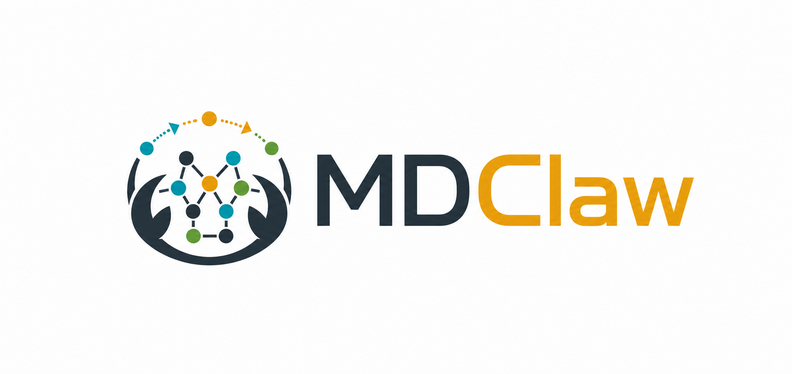

<p align="center">
  
</p>

# MDClaw

MDClaw helps AI coding agents prepare, run, and analyze molecular dynamics
(MD) simulations with AmberTools and OpenMM. Describe a system or a research
question in plain language; the agent uses MDClaw to plan the work, execute
calculations, and report the results.

MDClaw provides **skills** (instructions for the agent) and **command-line
tools** (the programs that perform the calculations). It records each step's
inputs, outputs, and status so work can be inspected and resumed later.
Use it with an agent such as Claude Code or Codex, or call the tools directly.

For interactive structure viewing and MD playback, the display skill selects
Molstar when a suitable MCP viewer, a reachable browser, or (in Claude Code) an
Artifact page is available; explicit
still-image requests use PyMOL. Preparation views retain translucent water,
while production views show only the solute (and lipids), wrap molecules, and
subsample long trajectories. Fitting is opt-in.

An attached Molstar MCP viewer can stream requested coordinates through Codex
Remote Control, without a separate SSH tunnel or downloading the DCD file.
For a local or already reachable browser, run
`pixi run mdclaw serve_molstar --structure-file /absolute/path/topology.pdb`
and add `--trajectory-file /absolute/path/trajectory.dcd` for playback. Open
the printed `viewer_url` and keep the command running while viewing. Mol* is
bundled. See the [viewer guide](docs/developer/molstar-viewer.md) for MCP setup,
remote connection alternatives, and host-specific verification limits.

### Molstar in Claude Code

Claude Code (terminal, Desktop Code tab, or Remote Control) does not render
MCP viewer widgets, so the display skill delivers Molstar as a private
claude.ai Artifact instead. On the host that stores the MD files:

```bash
mdclaw export_molstar_page \
  --structure-file /absolute/path/topology.pdb \
  --trajectory-file /absolute/path/trajectory.dcd \
  --stage prod --title "CLN025 prod_001" --output-file /tmp/cln025_prod.html
```

The agent then publishes the page with its Artifact tool, and you open the
link in the Desktop app or a browser to rotate and play the trajectory. The
page uses the same presentation, molecule wrap, water removal and sampling as
the MCP viewer, so it needs no MCP registration, port or SSH tunnel and works
behind firewalls. It embeds the retained display frames (production frames
are sampled to fit 8 MB), so do not use it when the data must stay on the host.
Just ask: **“Show prod_001 in Molstar.”** The display skill
(`skills/common/visual-qa.md`) picks this route in Claude Code.

**Compatibility:** Codex desktop Remote Control plays through the MCP viewer
(no coordinates leave the host). In Claude Code the MCP viewer was registered,
loaded and called successfully on 2026-10-26, but the client never requested
its UI, and Anthropic documents MCP Apps for claude.ai, Claude Desktop chat,
Cowork and mobile only; the Artifact page played the same trajectory in Claude
Desktop's Code screen. See the [display steps](skills/common/visual-qa.md#check-the-interactive-route).

## Install / Deploy

First prepare the scientific software on the machine that will run the
calculations: choose **Pixi** for a local environment or **SIF** for a Linux
server with Singularity/Apptainer. Then install the skills for your agent.

### On Your Workstation: Pixi

Install Pixi on Linux or macOS with the [official installer](https://pixi.prefix.dev/latest/installation/):

```bash
curl -fsSL https://pixi.sh/install.sh | sh
```

Restart your terminal so `pixi` is on PATH. In a directory outside cloud-sync
folders, run:

```bash
git clone https://github.com/matsunagalab/mdclaw.git
cd mdclaw
pixi install
export PATH="$PWD/bin:$PATH"
scripts/mdclaw-doctor.sh
```

Pixi installs the package versions recorded in `pixi.lock` into `.pixi/`.
`pixi.toml` and `pixi.lock` are the single definition of the scientific
runtime: workstations, compute servers and the published container image are
all built from them. Two environments cover the NVIDIA drivers in use:

| Environment | Command | Platforms and GPU stack |
|---|---|---|
| `default` | `pixi install` | Apple Silicon macOS (OpenCL), Linux x86-64/ARM64 with CUDA 12.9 (driver R575 or newer) |
| `cuda118` | `pixi install -e cuda118` | Linux x86-64 with CUDA 11.8 (driver R520–R574, e.g. floyd and n1–n5; Ubuntu 18.04 works) |

Both carry OpenMM 8.6.1, GPU PyTorch, openmm-torch with PythonTorchForce, and
PLUMED 2.9.4 with openmm-plumed. Pieces that no conda package provides are
built from `recipes/` during the first install (about 15–30 minutes, once);
in `cuda118` that includes OpenMM itself against CUDA 11.8. `bin/mdclaw` reads
the driver version and runs `cuda118` when the driver is older than R575 and
that environment is installed; `MDCLAW_PIXI_ENV=default|cuda118` overrides it.
For MODELLER on Linux ARM64, install its official ARM binaries after
`pixi install` with `pixi run python scripts/install-modeller-arm64.py`. Other
platforms install MODELLER through Conda; each user supplies their own
`KEY_MODELLER` at run time. Run the
[GPU calculation test](docs/developer/container.md#build-and-test) on each
node before production use. The `.pixi/` directory contains large,
machine-specific files and should stay outside cloud-sync folders.

The `export PATH` command makes `mdclaw` available in the current terminal.
For future terminals, add this checkout's **absolute `bin/` path** to your
shell startup file.

The doctor command checks OpenMM, AmberTools and Molstar MCP and reports usable GPU
platforms and optional features. Resolve any `[fail]` messages before running
calculations. Missing optional features only affect workflows that need them;
CPU-only machines can prepare systems and run short checks.

For the interactive MCP viewer, the SDK is included in this Pixi environment.
From the checkout, register it once on the host running Codex:

```bash
codex mcp add mdclaw_molstar --env MDCLAW_RUNTIME=pixi -- "$PWD/bin/mdclaw" molstar-mcp
```

Select the molecule after connecting; no example trajectory is needed at server
startup. The Codex plugin bundles this server (Claude Code needs none). For SIF
and other runtimes, follow
[Molstar MCP deployment](docs/agents/deployment.md#molstar-mcp-display).

### On A Compute Server: SIF

A SIF (Singularity Image Format) file packages MDClaw and its scientific
dependencies. The image is built from the same `pixi.lock` (the `cuda118`
environment, `container/Dockerfile.pixi`), so it runs on NVIDIA drivers R520
or newer. On an x86_64 (Intel/AMD) Linux server with Singularity installed,
download it with:

```bash
singularity pull mdclaw.sif docker://ghcr.io/matsunagalab/mdclaw:latest
```

The command downloads the container and converts it to a SIF locally. Allow
about 60 GB of free space for temporary files and the result; see
[temporary storage](docs/developer/container.md#singularity) if `/tmp` or
your home directory is small. The published image does not support ARM servers.

You do not need to clone this repository or install Pixi for this path.
Check the downloaded image:

```bash
export MDCLAW_SIF="$PWD/mdclaw.sif"
singularity exec --nv "$MDCLAW_SIF" mdclaw --version
singularity exec --nv "$MDCLAW_SIF" mdclaw inspect_openmm_platforms
```

Use `apptainer` instead of `singularity` in all commands if that is installed.
Run the GPU check on a GPU node; `--nv` makes its NVIDIA GPU available inside
the container. For CPU-only checks, omit `--nv`. Subsequent tools use the same
`singularity exec ... mdclaw <tool>` form. See [server setup and Slurm](docs/agents/deployment.md#sif-no-user-checkout-required)
for working-directory mounts and job submission.

### Connect Your Agent

If you work inside the MDClaw checkout, Claude Code and agents that read
`.agents/skills/` can discover the included skills directly. For other working
directories, choose **one** installation method below. Claude Code and Codex
can install the plugin without Node.js or `npx`; the skills CLI is an
alternative for either agent and for other supported agents.

Keep the Pixi or SIF runtime prepared above available to the agent. Installing
skills alone does not install the scientific software. Direct CLI use needs
no skills.

#### Claude Code Plugin (No Node.js Required)

In your terminal, with Claude Code already installed, run:

```bash
claude plugin marketplace add matsunagalab/mdclaw
claude plugin install mdclaw@mdclaw --scope user
```

`--scope user` makes the plugin available across your projects. To enable it
only for yourself in the current project, use `--scope local` instead.
Start a new Claude Code session, then use skills such as `/mdclaw:md-prepare`.
You can also add the marketplace and install from Claude Code's `/plugin`
screen. See [Claude Code's plugin guide](https://code.claude.com/docs/en/discover-plugins).

#### Codex Plugin (No Node.js Required)

With a recent Codex CLI that supports `codex plugin`, run in your terminal:

```bash
codex plugin marketplace add matsunagalab/mdclaw
codex plugin add mdclaw@mdclaw
```

This installs the plugin for your user account. Start a new Codex session and
ask it to use MDClaw. In the desktop app, reopen the app and check the Plugins
screen for MDClaw under the `mdclaw` marketplace. If `codex plugin` is not
recognized, update Codex first. See [OpenAI's plugin guide](https://developers.openai.com/plugins/build/plugins).

Both plugin methods include the shared `common` skill. The bundled startup
hook can prepare a container runtime; to reuse your downloaded SIF, set
`MDCLAW_SIF` to its absolute path and `MDCLAW_RUNTIME=singularity` (or
`apptainer`) before starting the agent. See [runtime selection](docs/agents/deployment.md#runtime-selection).

#### Skills CLI: Install Node.js First

`npx` runs tools distributed through npm, downloading them when needed. It
comes with npm in a standard Node.js installation; do not assume it is
already installed on your machine. It is needed only for this method.

1. Open the [official Node.js download page](https://nodejs.org/en/download).
   Choose an **LTS** release (22.20 or newer) and your operating system.
2. On macOS or Windows, download and run the installer. On Linux, select
   **nvm** and **npm** on that page and run the displayed installation commands
   in your terminal; nvm installs under your home directory without `sudo`.
3. Open a new terminal and check:

   ```bash
   node --version
   npm --version
   npx --version
   ```

Then install the skills with one of these commands:

**For the current project:** run this in that project's directory:

```bash
npx skills add matsunagalab/mdclaw
```

**For your user account, across projects:** run this from any directory:

```bash
npx skills add matsunagalab/mdclaw --global
```

`--global` (or `-g`) installs to the selected agents' user skill directories
under your home directory. It does not require administrator privileges.
Select your agent and install `common` together with the workflow skills.
To select an agent explicitly, add `--agent claude-code` or `--agent codex`.

[Deployment details](docs/agents/deployment.md) cover plugins, Pi,
Docker, existing Conda environments, runtime selection, and troubleshooting.
BioEmu and Boltz-2 are optional, separate installs; see
[model backend setup](docs/developer/configuration.md#model-backend-runtime).

## Ask In Plain Language

Start your agent in the directory where you want to keep the simulation
files. If using a SIF, give the agent its absolute path. Describe the target,
the work to do, and where to stop. For long simulations, use a GPU; if you
want jobs submitted through Slurm, say so explicitly.

**Prepare and equilibrate one system:**

```text
Prepare PDB 1AKE chain A as a protein-only explicit-water system using the
default force field and water model. Continue through default equilibration
and stop before production.
```

**Run a comparison and analyze the results:**

```text
Set up and run an apo-vs-holo MD study for the T4 lysozyme L99A
benzene-binding cavity (benzene-bound PDB 4W53). Test whether benzene
occupancy stabilizes the engineered hydrophobic cavity. Plan the minimal
job set, prepare and equilibrate it, run 50 ns of production per job,
analyze cavity hydration and ligand-pose observables, and return an
evidence-backed conclusion.
```

For a plan without execution, ask the agent to propose the study and stop
before running calculations. The skills instruct the agent to stay within
the requested scope and report any work that is still queued or running.

## Results And Resuming Work

Each study has a plan and one or more **jobs**: one job for a single starting
system, or several jobs for a comparison. A typical job follows these stages:

```text
Structure -> Preparation -> Solvation -> Force-field setup
          -> Minimization -> Equilibration -> Production -> Analysis
```

Free-energy calculations branch from the equilibrated system. Within a job,
variants and retries create new branches while preserving earlier results.

MDClaw records the stages and their dependencies as a directed acyclic graph
(DAG). Each stage keeps its inputs, outputs, and execution status. Depending
on how far the run proceeds, outputs include prepared structures, simulation
systems, trajectories, and analysis reports.

To continue later, give the agent the existing study directory and say what
to do next. The agent uses `inspect_job` to read progress, `explain_node` to
check the next step, and `trace_failure` to investigate a failed step. It can
reuse completed results without relying on the previous chat history.

## Supported Capabilities

The following workflows are available through the skills and CLI. Some need
optional software: check the doctor output and the relevant skill before use.

| Area | What you can do |
|---|---|
| Studies | Run a single system or compare several systems; resume work from completed stages and create branches for variants or retries. |
| Starting structures | Fetch PDB structures, AlphaFold predictions via UniProt, or use local PDB/mmCIF files. Select biological assemblies or models; optionally generate structures with Boltz-2, BioEmu, or MODELLER. |
| Molecular selection | Inspect and select proteins, DNA/RNA, ligands, waters, ions, glycans, and supported post-translational modifications (PTMs) before preparation. |
| Protein and nucleic acid force fields | Use Amber ff19SB by default, ff14SB as an alternative, DNA OL15, and RNA OL3. |
| Ligands, glycans, and PTMs | Prepare noncovalent small molecules with GAFF2 and OpenFF NAGL charges; select AM1-BCC with `--ligand-charge-method` or use it as fallback. Prepare covalently linked glycans with GLYCAM and phosphorylated serine, threonine, and tyrosine (SEP/TPO/PTR). |
| Solvent and membranes | Use explicit water (ff19SB + OPC, a 15 Å buffer, and 0.15 M salt by default), implicit solvent, vacuum, or Lipid21 membranes. Supported membrane mixtures include POPC/POPG. |
| Simulation | Minimize, equilibrate at constant volume or pressure (NVT/NPT), run production MD, restart or extend runs, and create replicates. Production defaults to a 4 fs step with hydrogen mass repartitioning (HMR). Optional PythonTorchForce scripts add custom bias forces and collective variables. |
| Free energy and enhanced sampling | Estimate folding free-energy changes for single point mutations using free-energy perturbation (FEP), or absolute binding free energies for neutral noncovalent ligands. Run weighted-ensemble kinetics, metadynamics, and SST2 solute tempering. |
| Analysis and reporting | Join and align trajectories; analyze structural deviations and fluctuations (RMSD/RMSF), distances, contacts, native-contact fractions, and equilibration. Record custom analyses and generate Methods-style reports with inputs, parameters, and result provenance. |
| Execution | Run locally with Pixi or Conda, use Docker or Singularity/Apptainer, or submit and monitor Slurm jobs and arrays. |

When a required check fails, the tool stops and reports the reason and next
action. Checks cover molecule selection, force-field templates, charges,
stage dependencies, and the files required to run a simulation. Recorded
failures remain available for inspection.

## Boundaries And Non-Goals

- **Modified DNA/RNA needs custom preparation.** The standard workflow stops
  rather than replacing a modified nucleotide with an ordinary one. The legacy
  modXNA helper is experimental; advanced users can supply their own OpenMM
  system or force-field definitions.
- **Only selected PTMs are supported.** Phospho-histidine, O-GlcNAc,
  acetylation, methylation, ubiquitination, lipidation, and selectable phosphate
  protonation states are not included in the standard workflows.
- **Specialized chemistry still needs an explicit model.** MDClaw does not
  automatically create covalent-ligand parameters, bonded metal-center models,
  or general organometallic chemistry. Supported bare structural ions are
  checked against the selected water/ion force-field templates.
- **The standard workflows use Amber force fields and OpenMM.** Other force
  fields, CHARMM-native preparation, coarse-grained or polarizable models, and
  combined quantum/classical calculations (QM/MM) need separate workflows.
- **Free-energy workflows have defined limits.** The [mutation FEP skill](skills/md-fep/SKILL.md)
  handles one point mutation, and the [absolute binding free-energy skill](skills/md-abfe/SKILL.md)
  handles one neutral noncovalent ligand. Automated campaigns for relative
  binding FEP between ligands, replica exchange, or umbrella sampling are not
  provided.
- **Successful execution does not establish scientific validity.** Passing
  topology, charge, energy, and output-file checks does not establish
  convergence, adequate sampling, or a biological conclusion. Those require
  appropriate controls, replicates,
  analysis, and expert review.

## Updating Skills

Update using the same method you used to install:

- **Claude Code plugin:** run `claude plugin marketplace update mdclaw`, then
  `claude plugin update mdclaw@mdclaw` in your terminal.
- **Codex plugin:** run `codex plugin marketplace upgrade mdclaw`, then
  `codex plugin add mdclaw@mdclaw` to refresh the installed copy.
- **Skills CLI:** run `npx skills update`.

Start a new agent session after updating a plugin. Update the scientific
environment or downloaded SIF separately; a skill update does not rebuild it.

## Development

From the MDClaw checkout, install the environment and run the standard checks:

```bash
pixi install   # locked env from pixi.toml + pixi.lock (installs mdclaw editable)
pixi run ruff check mdclaw/
pixi run pytest tests/test_registry.py tests/test_cli.py tests/test_guardrails.py tests/test_guardrail_code_registry.py tests/test_slurm_server.py -v
```

Short agent guidance is mirrored in `CLAUDE.md` and `AGENTS.md`; keep those
files identical. See the [architecture](docs/developer/architecture.md),
[tool reference](docs/developer/tool-reference.md),
[CLI internals](docs/developer/cli-internals.md),
[testing guide](docs/developer/testing.md), and
[configuration reference](docs/developer/configuration.md) for details.

### Repository Map

| Path | Role |
|---|---|
| `skills/` | Portable MDClaw skills. This is the source of truth for skill behavior. |
| `.agents/skills/` | Generic Agent Skills discovery entries, symlinked to `skills/`. |
| `.claude/skills/` | Repo-local Claude Code skill discovery entries, symlinked to `skills/`. |
| `.claude-plugin/` | Claude plugin marketplace metadata. |
| `.codex-plugin/` | Codex plugin manifest (adds the Molstar MCP server). |
| `hooks/` | Plugin lifecycle hooks, including packaged runtime setup. |
| `bin/mdclaw` | Runtime wrapper used by plugin and local deployments. |
| `pixi.toml`, `pixi.lock` | Locked definition of the scientific runtime: the `default` and `cuda118` environments and the container image. |
| `recipes/` | Source builds pixi runs on install: OpenMM for CUDA 11.8, openmm-torch, PLUMED, openmm-plumed. |
| `environment.yml` | Legacy conda definition, kept for existing envs and the arm64 image. |
| `.github/workflows/` | CI (pixi env tests on macOS/Linux) and the container build/publish workflow. |
| `mdclaw/` | Python package and CLI tool implementations. |
| `container/` | Image definitions: `Dockerfile.pixi` (published image, from the `cuda118` environment), the arm64 image, and the earlier `Dockerfile`. |
| `docs/agents/` | Deployment notes for agent harnesses. |
| `docs/developer/` | Architecture, CLI internals, testing, release, and tool references. |
| `tests/` | Unit, smoke, and integration tests. |

### Building And Publishing Releases

For maintainers, follow the [release guide](docs/developer/release.md).
`scripts/bump-version.sh X.Y.Z` writes
every version location at once, and pushing the `vX.Y.Z` tag triggers the
container workflow, which builds the image from `pixi.lock` with
`container/Dockerfile.pixi`, runs the CPU smoke test, and publishes the GHCR
tags. The GPU smoke test stays a manual
gate before shared SIFs are replaced.

## License

MDClaw is MIT-licensed ([LICENSE](LICENSE)). This repository contains only
MDClaw's own code, skills, and documentation; no third-party source is
vendored, so the MIT text is the only license in the source tree.

### Third-Party Software

MDClaw orchestrates scientific software that is installed separately — from
conda-forge/PyPI via pixi or conda, or prebuilt inside the published
container image — and that remains under its own license. The main runtime
components (license identifiers as declared by the installed packages):

| Component | License |
|---|---|
| OpenMM | LGPL-3.0-or-later |
| AmberTools | GPL-3.0-or-later AND LGPL-3.0-or-later AND BSD-3-Clause AND MIT |
| MDAnalysis | LGPL-3.0-or-later |
| MDTraj | LGPL-2.1-or-later |
| ParmEd | LGPL-2.1-or-later |
| PLUMED (container image only) | LGPL-3.0 |
| propka | LGPL-2.1 |
| SST2 | GPL-2.0 (invoked as a separate subprocess) |
| RDKit, PyTorch | BSD-3-Clause |
| pdb2pqr | BSD-style |
| PDBFixer, openmmforcefields, OpenFF toolkit / NAGL / Pablo, pymbar, e3nn, HPacker | MIT |
| BioEmu, Boltz-2 (optional model backends) | MIT |
| dimorphite-dl, HOLE2 | Apache-2.0 |
| gemmi | MPL-2.0 |
| PyMOL (open-source build) | PyMOL Open-Source License |
| MODELLER | Proprietary; free for academic use with a registered license key |

The container/SIF images redistribute these components in binary form; the
license texts travel inside the image with each conda package
(`/opt/mdclaw/conda-meta/` and the packages' `share/` directories). Two
components need explicit care: MODELLER ships in the image **without** a
license key — each user supplies their own `KEY_MODELLER` at run time and
accepts the salilab academic-use terms — and SST2 (GPL-2.0) is executed as a
standalone subprocess rather than imported. MDClaw's MIT license covers only
MDClaw's own files; using or redistributing the images means honoring the
component licenses above.
