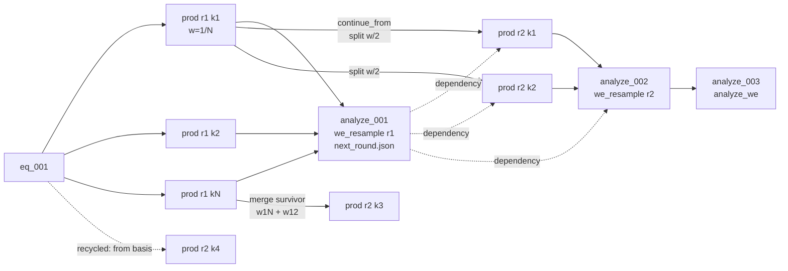

# Implementation Plan for Putting Round-Driven Sampling (Replica / Weighted Ensemble) on the DAG

Created: 2026-09-21 (Claude made the user's proposal concrete by surveying the MDClaw code in practice. The same day,
following the user's direction "avoid a WE-specific design, use the existing DAG, and make it reusable for other MD methods",
it was restructured into generic round driving with WE as one policy. For review before implementation.)

## 0. Terminology and Correspondence with the User's Proposal

| Term | Meaning |
| --- | --- |
| replica / walker | One trajectory. In WE it carries a weight |
| round (iteration) | One cycle that advances every replica by τ and decides the next batch |
| segment | One replica's trajectory piece for one round. **segment = one `prod` node** |
| batch | The set of `prod` nodes of one round |
| scheme | The definition of round driving (policy, τ, number of replicas, start node, execution method). `progress.json.params.sampling_schemes[<id>]` |
| policy | The rule that decides the next batch at the end of a round. `replicas` (continue all; built in) or an analyze tool (`we_resample` …) writes `next_round.json` |

| User's proposal | This plan |
| --- | --- |
| Store the weight on the prod node | The segment node's `conditions.weight` (at creation, a copy of the plan) and `metadata.weight` (at completion). The ledger is the policy node's `next_round.json` |
| When split, the weight is split too | `we_resample` writes child specs (parent, start state, weight, seed) to `next_round.json`, and `run_rounds` creates child nodes from it with `continue_from=<parent>` + `dependency_node_ids=[policy node]` |
| The split decision is made in an analysis node whose parents are the prod group | One analyze node per round. Parents = all segments of that round (`create_node` already allows multiple prod parents). `analysis_data_scope: segment` |
| WE analysis in a terminal analysis node, kinetics by fitting | `analyze_we`. Parent = policy node (analyze→analyze parents are already allowed). §7 |
| It would be handy if `run_we` also worked for replicas / use the existing DAG and other methods too | The driver is `run_rounds` (policy-independent). `--policy replicas` runs "N seeds × k continuations" both locally and under MPS. The only WE-specific parts are `we_resample` and `analyze_we` (§5) |

---

## 1. Policy

- Do not add new node types, new scopes or new state formats. Use `prod` / `analyze`, `continue_from`, `dependency_node_ids`, `conditions`, `update_job_params`, `submit_mps_job` / `submit_array_job` as they are.
- Make the "prod group → analysis → next prod group" round a **generic contract**. WE, simple replicas, SST2's "adaptive block → `analyze_tempering` → fixed-weight block", and adaptive sampling (restart from a frame) all take this shape.
- Put guardrails in the tool (CLAUDE.md). The WE failures that "produce numbers but are wrong" (siblings with the same seed giving identical trajectories, weights summing to ≠ 1, resampling before the round is complete, a rate without reaching the target) are refused with a `code`.
- Goal (scientific): obtain transition rate constants and MFPTs from unbiased dynamics. Targets are (i) folding of peptides and small proteins (pcoord: q / rmsd), (ii) conformational change (pcoord: 2-D RMSD to reference structures of states A and B, or a dihedral; target = neighbourhood of B), (iii) ligand unbinding and binding (pcoord: intermolecular distance + ligand RMSD; k_off and concentration-normalized k_on).

---

## 2. Facts in the Code (Surveyed 2026-09-21; Constraints on the Design)

| # | Fact | Impact |
| --- | --- | --- |
| 1 | `create_node(parent_node_ids, dependency_node_ids, label, conditions, continue_from)`. The only metadata is `continued_from`. Each call takes a lock + rewrites all of `progress.json` + runs the `explain_node` preflight (`node/lifecycle.py:243`) | At 10⁴ nodes (4 MB), 100 nodes per round ≈ 10–20 s. Acceptable if MD is several minutes per round. A bulk version only when measurement shows it is needed (v1.5) |
| 2 | `_ALLOWED_PARENT_TYPES`: `prod ← {eq, prod}`, `analyze ← {prod, fep, analyze}`. Multiple prod parents of an analyze are `branches_input`. `dependency_node_ids` must be completed at run time (`validate_node_execution_context`) | The round shape can be built as is. With the child segment's `dependency_node_ids=[policy node]`, the tool guarantees "runs after the plan is finalized" |
| 3 | `_resolve_md_restart`: `continued_from` takes top priority, then `state` → `checkpoint`. `read_ancestor_final_step` restores the step | Child segments use `continue_from=<parent segment>`. A child restarting from the basis (recycling) takes the basis node (`eq` or `prod`) as its parent |
| 4 | `run_production` seeding: `_restart_random_seed(random_seed, restart_step)` (`production.py:760`). Siblings with the same parent and same seed get **the same seed → identical trajectories** | Fatal for both replicas and WE. `propagate_batch` requires a per-node `random_seed`, and `run_production` gets a sibling-collision guard |
| 5 | `_load_state_into_simulation` takes `.xml` / `.chk`. Transfers only positions / velocities / box | Do not change the state format. 8–10 MB of XML at 70k atoms; saving ≈ 1 s |
| 6 | `_walk_prod_chain_from` follows `continued_from` → first parent and stops at a non-prod | Replica / walker lineages can be concatenated with `concat_trajectory` as is |
| 7 | `dag_snapshot` lists every `completed` id, and `dag` is PROTECTED (`node/snapshot.py`, `_envelope.py`) | MB-scale output every time at 10⁴ nodes. Add a cap (generic) |
| 8 | `submit_job(script=<command string>)` can be submitted without a node. Tasks of `submit_mps_job` / `submit_array_job` require a `node_id` | For executors `mps` / `array`, task = segment node (the current contract as is). The driver itself can be submitted with `submit_job --script` |
| 9 | Shared SIF: OpenMM 8.5.1 (`DCDReporter(..., atomSubset=None)`), scipy 1.18, mdtraj 1.11.1, pymbar 4.2 | Solute-only DCD, `curve_fit`, mdtraj rmsd / dihedral / contacts |
| 10 | `analyze_tempering`: gathers its parent prod group itself and writes a `verdict` and `_frames.csv`. `run_sst2`: `@node_tool("prod")`, `validate_node_execution_context(actual_conditions=…)`, sidecar | Write in the same style |
| 11 | Codes use the keyword form `code="…"` (scanner). Golden files: `tests/data/guardrail_codes.json`, `cli_contract.json`. `test_registry.py` has 17 servers | 18 with a new server `rounds` (tentative) |
| 12 | 1KXV (71k atoms) GB200 alone ≈ 820 ns/day; 8 MPS processes give 2.65× aggregate (52k atoms) | τ = 50 ps ≈ 5 s/segment (local-batch). Process startup is 10–20 s, so executor `mps` needs τ ≳ 200 ps |
| 13 | `run_production` writes a `runtime_system.xml` (≈ 10 MB) and an all-atom DCD per node | If producing many short segments, share it per batch and use a solute-only DCD |

---

## 3. Generic Components (Shared by Replicas / WE / Future Adaptive Sampling)

### 3.1 scheme (`params.sampling_schemes[<id>]`, validated and recorded by `setup_rounds`)

```json
{
  "scheme_id": "h3flip",
  "policy": "weighted_ensemble",            // "replicas" | "<analyze tool name>"
  "policy_args": {...},                       // passed to the policy tool (WE: pcoord, bins, walkers_per_bin, target, recycle)
  "stage_tool": "run_production",             // tool that runs a segment (run_sst2 also allowed)
  "stage_args": {"simulation_time_ns": 0.05, "pressure_bar": 1.0, "output_frequency_ps": 10,
                 "trajectory_selection": "protein", "platform": "CUDA"},
  "start": {"node_ids": ["eq_001"], "n_replicas": 20},   // replicas: n with different seeds. WE: M per bin
  "seed": 20260921,
  "retention": {"prune_states_after_rounds": null}      // default null (delete nothing)
}
```

### 3.2 `run_rounds` (job level, policy-independent, re-entrant)

```
loop:
  batch = incomplete segments if any; otherwise create them with create_node from the previous round's next_round.json (the scheme for round 1)
  propagate(batch, executor)      # local-batch | local | mps | array
  if policy != "replicas":
      create an analyze node (parents = batch, dependency = previous policy node), run the policy tool, get next_round.json
  stop? (--max-rounds / --max-aggregate-ns / --max-wall-hours / stop instruction from the policy)
```

- executor `local`: calls each node's stage tool (default `run_production`) sequentially in this process (§3.3). `mps`: submits to `submit_mps_job` with task = node and waits for completion by looping `check_job` with `--wait` (added after measurements on Ala3 / chignolin). `--chain` (self-submitting the next round's `run_rounds` with `afterok`) is v1.5.
- Re-entry: looks only at the DAG. Pending segments are run; for a failed segment, a sibling with the same parent, same weight and a new seed is created (three consecutive failures in the same lineage give `rounds_replica_unstable`); if the policy node is completed it is skipped.
- `--policy replicas`: no analyze node. Each replica chains k segments with `continue_from`. Replaces the bash loop in the existing `submit-mps.md`.
- `conditions` of each segment node: `scheme_id`, `round`, `replica`, `random_seed`, `parent_segment` (node id | null), `weight` (when the policy supplies it). Label `"<scheme>:r<round>:<replica>"`.
- `retention.prune_states_after_rounds = K` (opt-in): after a round completes, delete the `state` of segments older than K rounds and write a `state_pruned` event on the node; `_select_md_restart_ancestor` returns `restart_state_pruned` when the file is missing (next_action: branch from a descendant still retained, or redraw velocities from the final frame).

### 3.3 Running a Segment = Calling `run_production` As Is (User Decision, 2026-09-21)

Do not create a new execution tool. Executor `local` calls
`run_production(job_dir=…, node_id=…, random_seed=<node's condition>, …)` as a function for each segment inside the driver process.
Executor `mps` makes the same command a task of `submit_mps_job`.

- Overhead estimate (in-process call): Simulation construction (CUDA context 1–3 s) + XML read/write (0.5 s for a small system, 2 s at 70k atoms) ≈ 2–4 s / segment. For peptides and small proteins (10k–30k atoms, 1–3 µs/day on GB200), τ = 100–200 ps gives 4–15 s of MD, so overhead is 20–30 %. A separate process (`mps`) adds import time, so τ ≳ 200 ps. Measure and write it into the skill.
- Disk: `run_production` writes a `runtime_system.xml` (1–2 MB for a small system, 10 MB at 70k atoms) and `final_structure.pdb` per segment. 10–100 GB for 10⁴ segments. Acceptable for small systems; when it gets large, delete with retention (opt-in).
- seed: `run_rounds` derives each segment's `random_seed` from (scheme seed, round, replica) and writes it into the conditions; `run_production` turns it into a different effective seed per sibling via `_restart_random_seed(seed, restart_step)`. The accident of hand-made siblings with the same seed giving identical trajectories is refused on the `run_production` side with `production_sibling_seed_collision`.
- An SST2 round just calls `run_sst2` with the same executor (`stage_tool`).

### 3.4 Rules for Node ids (Folder Names)

Current ids are per-type sequence numbers `<type>_<seq:03d>` (`_next_node_id`, which ignores non-numeric suffixes).
Nodes created by a scheme are numerous, so they get structured ids from which scheme / round / replica can be read from the folder name alone.
They can coexist with sequential ids and do not affect `_next_node_id`'s numbering.

| Node | id | Example |
| --- | --- | --- |
| Ordinary node | `<type>_<seq:03d>` (unchanged) | `prod_007` |
| Scheme segment | `<type>_<scheme>_r<round:04d>_w<replica:04d>` | `prod_h3flip_r0013_w0050` |
| Scheme policy node | `analyze_<scheme>_r<round:04d>` | `analyze_h3flip_r0013` |
| Terminal analysis | Ordinary sequence number | `analyze_004` |

- `scheme_id` is restricted to `[a-z][a-z0-9]{0,15}` (lowercase alphanumerics, no underscore) so the id delimiters are unambiguous (`rounds_scheme_invalid`).
- `r` = round, `w` = walker / replica number. `ls nodes/` sorts in scheme → round → replica order.
- Assignment is via `create_node`'s private argument `_node_id` (arguments starting with an underscore are not exposed on the CLI; only `run_rounds` passes it, and the format and uniqueness are validated). The public `node_id` argument is refused as before (the agent never chooses an id).
- Places that enumerate ids in a large DAG (`dag_snapshot`, `existing_node_ids` of `node_missing_error`, `parent_required` candidates, `describe_nodes`) get a cap (Phase 0, generic).

### 3.5 Other Generic Changes

- `dag_snapshot`: each list over 40 entries becomes the first 20 + last 20 plus the count (`truncated: true`). `existing_node_ids` of `node_missing` and the `parent_required` candidates get the same cap.
- CV evaluation `mdclaw/analyze/cv.py`: `distance` (centre of mass; raw within a molecule, minimum image between molecules; reuses `restraints.resolve_centroid_groups`. Intermolecular targets are limited to under half the box length: `we_target_exceeds_half_box`), `rmsd` (reference PDB; superpose on `align_selection`, measure on `selection`: superposing on the protein and measuring on the ligand is the pcoord for unbinding and binding), `dihedral` (4 atoms, `md.compute_dihedrals`), `q` (Best–Hummer–Eaton fraction of native contacts). Evaluated per frame from the trajectory (DCD + topology). Folding needs rmsd / q and unbinding/binding needs distance + rmsd, so all four are v1.
- A solute-only DCD (`--trajectory-selection`) is unnecessary for small systems (10k atoms × 1 frame/segment × 10⁴ = 1.2 GB). Add it as a generic `run_production` option when large systems need it.

---

## 4. DAG Shape (for WE)



With `--policy replicas` there are no analyze nodes; each replica is simply a `continue_from` chain. `inspect_job` / `explain_node` / `trace_failure` / `concat_trajectory` work without modification.

---

## 5. WE-Specific Components

### 5.1 `we_resample` (Policy Tool, `@node_tool("analyze")`)

Parents = all segments of the round. `policy_args` is read from the scheme.

- Evaluate the pcoord (1–2 dimensions, the CVs of §3.4) from each segment's trajectory (bin assignment on the last frame; all frames go to `pcoord.csv`).
- bins: per-dimension `edges` (the outer edges are auto-completed with ±inf, with a warning). `walkers_per_bin` M (default 5).
- Procedure (Huber–Kim, the WESTPA default): bin assignment → recycling (walkers in `target` restart from the basis keeping their weight, counted in the flux) → per bin, if n > M merge the two lightest (the survivor is drawn in proportion to weight; weights are summed), if n < M split the heaviest in two → check Σw (normalize if |1 − Σw| < 1e-12, record the residual). Random numbers are deterministic from (scheme seed, round).
- Outputs `next_round.json` (generic contract: `children[] = {replica, parent_node_id | basis_node_id, weight, random_seed, label}`) and `we_round.json` (per-walker bin / pcoord / fate, bin populations, flux, weight min/max). A walker that disappears in a merge is sealed, so a `merged_into` event is written on the disappearing side.
- v1.5: weight-ratio split/merge thresholds, MAB (adaptive bins).

### 5.2 `analyze_we` (Terminal, §7)

---

## 6. `next_round.json` (Generic Contract) and `we_round.json` (WE Ledger)

```json
// next_round.json — read by run_rounds. Same shape regardless of policy
{"scheme_id": "h3flip", "round": 12, "stop": false,
 "children": [
   {"replica": 1, "parent_node_id": "prod_1203", "weight": 0.00615, "random_seed": 91203001, "label": "h3flip:r13:1"},
   {"replica": 50, "basis_node_id": "eq_001", "weight": 0.004, "random_seed": 91203050, "label": "h3flip:r13:50"}
 ]}

// we_round.json — the WE ledger
{"walkers": [
   {"node_id": "prod_1203", "replica": 3, "weight": 0.0123, "pcoord": [1.42], "bin": 7, "fate": "split", "children": [1, 2]},
   {"node_id": "prod_1204", "replica": 4, "weight": 1.0e-6, "pcoord": [1.40], "bin": 7, "fate": "merged", "merged_into": "prod_1203"},
   {"node_id": "prod_1250", "replica": 50, "weight": 0.004, "pcoord": [2.9], "bin": 19, "fate": "recycled"}],
 "flux": {"weight_recycled": 0.004, "events": 1, "flux_per_ns": 0.08},
 "bins": [{"index": 7, "weight": 0.031, "n_in": 9, "n_out": 5}],
 "weight_sum_in": 1.0, "weight_sum_out": 1.0, "weight_residual": 1.1e-16}
```

After `run_rounds` creates the child nodes, their ids are appended as `round_children.json` next to the policy node's artifacts (the policy node's node.json is not changed).

---

## 7. Terminal Analysis `analyze_we` (Kinetics)

Parent = the last policy node (multiple parents for comparing / pooling multiple schemes). Walks back through `dependency_node_ids` to gather `we_round.json` from every round.

- `we_iterations.csv`: round, time_ns (= r·τ), n_walkers, flux (recycled weight / τ), cumulative flux, P_target (target weight before recycling), weight min/max, bins occupied.
- `we_bins.csv` / `we_pcoord_hist.csv`: bin populations after burn-in and the frame-weighted pcoord histogram (−kT ln P). With recycling, state explicitly that it is the "NESS distribution".
- `we_frames.csv`: walker, node_id, round, frame, time_ns, weight, pcoord… (same role as `tempering_frames.csv`).
- rate (automatically from the scheme's `recycle`):
  - **With recycling (NESS)**: k_AB = steady-state mean of the flux, MFPT = 1/k. Fit F(t) = F_ss (1 − e^{−t/τ_r}) with `curve_fit`; if the mean over the final 1/4 is within the error of F_ss, `flux_steady`, otherwise `flux_transient` (reported as a lower bound). Zero events gives `we_no_target_events` (completes without a rate). For unbinding (basis = bound state, target = unbound state), k_off = flux_ss. For binding (basis = unbound state, target = bound state), report k_on = flux_ss / C, C = 1 / (N_A ⟨V⟩) (one ligand in the box; ⟨V⟩ from the segments' state / energy) alongside in M⁻¹s⁻¹, and put in the verdict the caution that the smaller the box, the more k_on is overestimated.
  - **Without recycling**: two-state fit of P_B(t) = P_B^∞ (1 − e^{−(k_AB + k_BA) t}). k_AB = k_tot P_B^∞, k_BA = k_tot (1 − P_B^∞).
  - Error: block bootstrap over rounds (block length ≈ τ_r); with multiple schemes, mean ± SEM.
  - v1.5: history labels (Suárez 2014), RED correction (DeGrave 2021), haMSM.
- `verdict` / `verdict_reasons` (same form as `analyze_tempering`), figures (flux vs time + fit, bin populations, pcoord distribution).

---

## 8. Guardrails (code)

| code | Occurs when | Handling |
| --- | --- | --- |
| `rounds_scheme_invalid` | Malformed scheme JSON (unknown policy, unknown stage_tool, start node not eq/prod, pcoord and bin dimensions mismatch in WE) | Refuse |
| `rounds_scheme_exists` | The same id exists | Refuse (`--overwrite` only while at round 0) |
| `rounds_round_incomplete` | There are pending/running/failed segments when the policy runs | Refuse (`run_rounds` fills them first) |
| `rounds_plan_applied` | That policy node already has children | Return the existing ones (idempotent) |
| `rounds_batch_heterogeneous` | The nodes of a `propagate_batch` do not match in topo / settings | Refuse |
| `rounds_seed_required` | A segment has no `random_seed` | Refuse |
| `rounds_replica_unstable` | The same lineage fails three times in a row | Stop the driver |
| `production_sibling_seed_collision` | In `run_production`, a completed sibling with the same parent, same step and same seed | Refuse |
| `restart_state_pruned` | Restart from a state deleted by retention | Refuse + alternative procedure |
| `we_policy_args_invalid` | Malformed pcoord / bins / target / basis | Refuse |
| `we_pcoord_selection_invalid` | Selection is empty / contains solvent / atom count differs from the reference | Refuse |
| `we_weights_invalid` | Input weights sum deviates from 1 by 1e-9 or more, or are negative / non-finite | Refuse |
| `we_pcoord_out_of_bins` | Out of range with bins whose ±inf completion is turned off | Refuse |
| `we_target_exceeds_half_box` | An intermolecular-distance target / bin edge exceeds half the box length | Refuse |
| `we_no_target_events` | Zero recycling events when a rate is requested | Reported in the verdict |

---

## 9. Phases

| Phase | Content | Tests | Estimate |
| --- | --- | --- | --- |
| 0 | Generic groundwork (minimal): structured ids (`create_node`'s `_node_id`, §3.4), caps on `dag_snapshot` and id enumeration, sibling seed-collision guard in `run_production` | Update existing golden files; tests in `test_node.py` for structured ids coexisting with sequential ones and for seed collisions | 1–2 days |
| 1 | Generic rounds: `mdclaw/rounds/` (`setup_rounds`, `run_rounds`, executor `local` (calls `run_production` in-process), policy = replicas / policy tool, `next_round.json`, re-entry), registry, codes, envelope `next` (the next step for a scheme node is `run_rounds`) | `test_rounds.py`: 3 replicas × 3 rounds on a 2-atom XML artifact triple with Reference, interrupt and resume, rerun of failed segments | 3–4 days |
| 2 | WE: `analyze/cv.py` (distance / rmsd / dihedral / q), `we_resample` (bins, split/merge, recycling), `analyze_we` (flux fit, two-state fit, bootstrap) | `test_we_resample.py` (weight conservation, split/merge counts, recycling, determinism), `test_we_kinetics.py` (run the resampler + estimators through a Markov chain on a 1-D double well; agrees with the brute-force rate), `test_we_nodes.py` (WE 3 rounds × 4 walkers with the bond length of a 2-atom system as pcoord) | 1 week |
| 3 | GPU measurements: (a) end-to-end distance of capped Ala3 (same CV and system as SEUS), comparing the extended↔contracted rate with plain MD and measuring per-segment overhead and per-round DAG I/O, (b) chignolin folding (Q / RMSD) compared with literature values, (c) unbinding of a small-molecule guest from β-cyclodextrin (k_off ≈ 10⁶–10⁸ s⁻¹) compared with brute force | Numbers in the memo | 1–2 weeks |
| 3.5 | Things decided by measurement: executor `mps` + `--wait`, retention (opt-in), bulk versions of `create_node` / `complete_node`, solute-only DCD | — | After measurement |
| 4 | Operations and docs: `skills/md-production/rounds.md` (replicas), `skills/md-we/` (SKILL.md + pcoord-and-bins.md + kinetics.md), `tool-reference.md`, the DAG section of `architecture.md`, memo | Level 4 | 3–5 days |

Phases 0–2 can be completed on CPU inside the container. Run a thin vertical slice through Phase 0 → 2 before going to Phase 3.

---

## 10. Risks

| Risk | Details | Mitigation |
| --- | --- | --- |
| Node count | 10⁴-scale prod nodes. `progress.json` 4 MB, 3×10⁴ files in `events/` | Creating and completing 100 nodes per round ≈ 10–20 s. Bulk versions as it approaches 10⁵ (v1.5). `nodes` of `inspect_job` is already stubbed in brief |
| Disk | All-atom DCD and XML state | `trajectory_selection`, opt-in retention. At 70k atoms the state is 10 MB/segment, so 10⁴ segments = 100 GB |
| Solute DCD and existing metrics | Atom count does not match the topo | The resolver prefers `trajectory_topology` (generic change) |
| Startup cost of executor mps | 1 task = 1 process | Write τ ≳ 200 ps into the skill. Sharding in v2 |
| Orthogonal slow degrees of freedom | Bins are on the pcoord only | Detect with a 2-D pcoord and the variance across multiple schemes. History labels / haMSM in v1.5 |
| Rate before steady state | Misreading a transient as steady | `flux_transient` from agreement between the fit and the final 1/4 |
| Siblings with identical trajectories | Fact #4 | Per-node seed required + `run_production` guard |
| Sealed nodes in merges | Cannot write to a walker that disappeared | `we_round.json` and events |

---

## 11. Progress (2026-09-21)

- Implemented Phases 0–2 and passed the CPU tests (see memo 2026-09-21): `mdclaw/rounds/` (`setup_rounds` / `run_rounds` / `inspect_rounds`), `mdclaw/analyze/cv.py`, `mdclaw/we/` (`we_resample` / `analyze_we`), `create_node`'s `_node_id` / `_metadata`, the cap on `dag`, `production_sibling_seed_collision`.
- On a 1-D lattice double well (`tests/test_we_kinetics.py`), resampler + recycling + steady-state flux agrees with the inverse of the exact MFPT to within 30 %.
- Next: Phase 3 (GPU measurements: Ala3 → chignolin → β-CD), and decide on executor `mps` / retention / bulk versions from the results.
- 2026-09-21 night: implemented executor `mps` (tester WE-4; the `mps + wait` item among the "things decided by measurement" in §3.5). The driver runs on the host, segments are `submit_mps_job` tasks, and the policy goes through the launcher. Details in the same-day entry of `docs/memo.md`.
- Same night: with an owner record + heartbeat (`mdclaw/rounds/owner.py`), `run_rounds` recovers running nodes left by a dead driver (WE-16). Roadmap: an option to run k segments sequentially in one MPS task (WE-17, amortizing startup cost; requires changing the task = node contract).
- Same night: `close_rounds` (WE-18), `--no-requeue` + held detection for MPS jobs (WE-19), re-reading progress.json in the CLI preflight (a transient read failure on the compute node side had been misjudging the parent as missing). Details in the memo.
- 9/22: `run_segment_batch` + `--mps-segments-per-task` (WE-17; the default is automatic, increasing k once the GPU's slots are filled). WE-3 deferred by user decision (keep the segments' runtime_system.xml / checkpoint). The kinetics verdict was extended in WE-21 to WE-24 with steady-state intervals, a level check and a sensitivity table.
